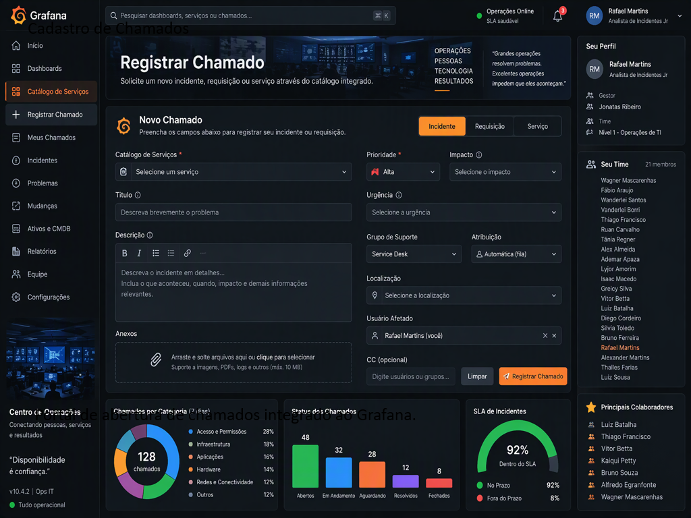
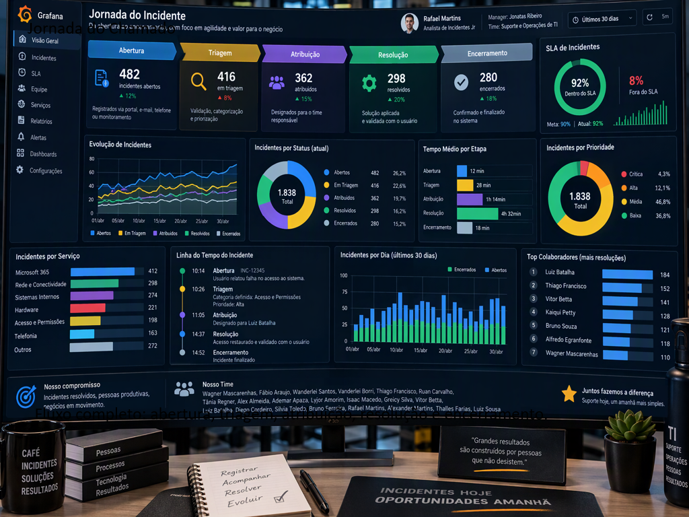
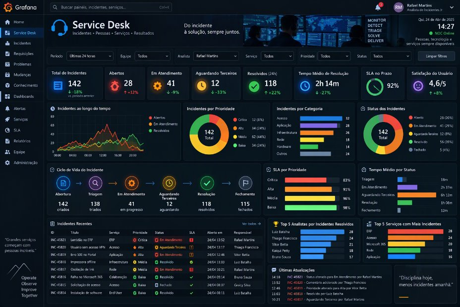
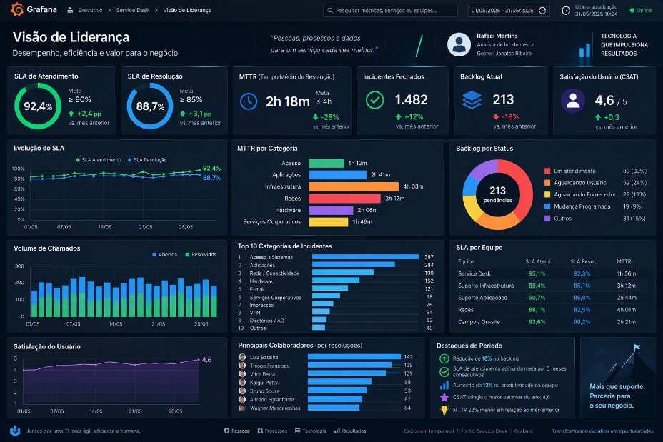

# Service Desk - Gestão de Incidentes no Grafana

Projeto de Service Desk para centralizar chamados, acompanhar incidentes ponta a ponta e dar visibilidade em tempo real para operação e liderança.

## 01 - Benefícios Esperados

- Centralização dos chamados
- Acompanhamento ponta a ponta
- Dashboards em tempo real
- Controle de SLA e MTTR
- Visão executiva para liderança
- Base para automações futuras

## 02 - Próximos Passos

1. Treinamento da equipe de suporte
2. Expansão para todos os setores
3. Ajustes nos dashboards conforme feedback
4. Evolução para automação e integração com outras ferramentas

## 03 - Registrar Chamado no Grafana

Tela de cadastro simples e rápida para abertura de chamados, com prioridade, categoria e responsável.

## 04 - Jornada do Incidente

**Abertura > Triagem > Atribuição > Resolução > Encerramento**

Fluxo completo do incidente, do registro até o fechamento com registro de aprendizado.

## 05 - Dashboard Operacional / Service Desk

Visão completa da operação para o time de plantão: total de incidentes, SLA, ciclo de vida, incidentes recentes e por status.

## 06 - Visão de Liderança

Visão executiva para gestão: SLA, MTTR, Backlog, CSAT e tendências para tomada de decisão.

