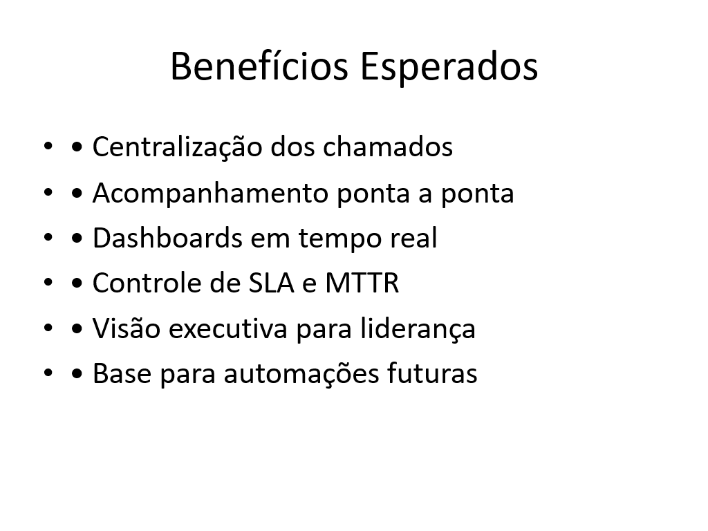

# 🎫 Service Desk - Monitoramento com Grafana


> Dashboard completo para monitoramento de Service Desk em tempo real. Visão gerencial de chamados, SLA, performance da equipe e gargalos operacionais.

## 📸 Como Funciona na Prática

### 1. Visão Geral do Service Desk

> Aqui é o coração do projeto. Dá pra ver todos os chamados abertos, em tempo real, sem precisar abrir planilha.

### 2. Registrar um Chamado

> É aqui que o chamado nasce. Quando abre um chamado, ele já entra no dashboard na hora.

### 3. Jornada do Incidente

> Mostra o caminho do chamado: abriu, foi atendido, foi resolvido. Assim dá pra saber onde ele trava.

### 4. Visão da Liderança

> Visão pra quem gerencia: SLA, volume, o que está estourando. Pra decidir rápido, sem chute.

### 5. Benefícios Esperados

> O resultado final: menos tempo de espera, mais controle e time sabendo onde focar.


---

## 🎯 O que esse projeto resolve?

Sem monitoramento, o Service Desk trabalha no escuro: ninguém sabe quantos chamados estão abertos, qual SLA está estourando, ou onde está o gargalo.

Este projeto resolve isso com:

- ✅ **Visão em tempo real** de todos os chamados
- ✅ **Controle de SLA** - sabe na hora o que está atrasado
- ✅ **Performance por analista / equipe**
- ✅ **Identificação de gargalos** por categoria e prioridade
- ✅ **Base para decisão gerencial** com dados, não achismo

---

## 📊 O que o Dashboard mostra

- **Chamados Abertos x Fechados**
- **Tempo Médio de Resolução (MTTR)**
- **Chamados por Prioridade (P1, P2, P3, P4)**
- **Chamados por Categoria**
- **SLA - Dentro do prazo vs Estourado**
- **Top Analistas / Equipes**
- **Volume de chamados por dia / hora**

---

## 🏗️ Arquitetura
Fonte de Dados (MySQL / CSV) -> Grafana -> Dashboard Service Deskjavascript
**Fluxo:**
1. Dados de chamados coletados na base
2. Grafana conecta na fonte de dados
3. Painéis transformam dados em gráficos e alertas
4. Gestor visualiza tudo em tempo real

---

## 🛠️ Tecnologias

| Tecnologia | Para que foi usada |
| :--- | :--- |
| **Grafana** | Visualização, dashboards e alertas |
| **Prometheus / MySQL** | Fonte de dados dos chamados |
| **Docker** | Subir o ambiente rápido |
| **SQL** | Consultas e métricas |

---

## 🚀 Como Rodar o Projeto

### 1. Clone o repositório
```bash
git clone https://github.com/silvamartinsrafa-rgb/service-desk-grafana.git
cd service-desk-grafana2. Suba o Grafana com Dockerbashdocker compose up -d3. Acessejavascripthttp://localhost:3000
Login: admin / admin📁 Estrutura do Projetojavascriptservice-desk-grafana/
├── docs/               # Prints e documentação (01 a 12)
├── dashboards/         # JSON exportado do Grafana
├── queries/            # Queries SQL usadas
├── docker-compose.yml  # Ambiente Grafana
└── README.md📈 Resultados / Aprendizados
Aprendi a criar dashboards gerenciais focados em decisão, não só em gráfico bonitoAprendi a modelar métricas de SLA, MTTR e volumeAprendi a documentar um projeto completo do zero ao GitHub🔗 Conecte-se comigo
Rafael Silva Martins - Analista de Service Desk | Monitoramento & Observabilidade
GitHub: https://github.com/silvamartinsrafa-rgb